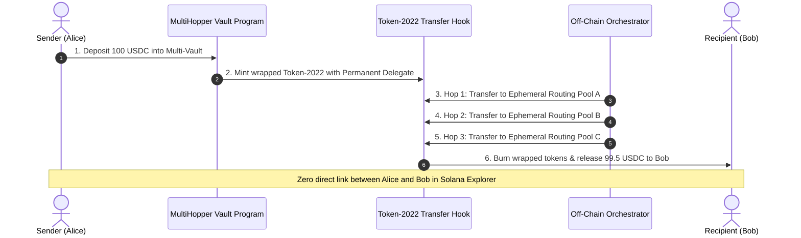

# @multihopper/agent-sdk 🦘🔐

> **Autonomous AI Agent MCP Server, Developer SDK & CLI for Private Multi-Hop Routing on Solana using Token-2022 Transfer Hooks.**

Built for the **MultiHopper Build & Route Challenge** on [Superteam Earn](https://earn.superteam.fun/listings/bounties/multihopper-build-and-route-challenge-up-to-dollar50000-revenue-share-1) ($5,000 USDC prize pool, scaling up to $50,000 + 0.25% perpetual builder revenue share).

---

## 🌟 Overview

**MultiHopper** is the premier private transaction routing protocol on Solana. By locking standard SPL tokens in multi-vault escrow contracts and minting wrapped Token-2022 tokens configured with permanent delegates and custom transfer hooks, MultiHopper executes off-chain orchestrated multi-hop transfers. This completely severs on-chain transaction linkage between the sender and recipient without requiring trusted mixers.

`@multihopper/agent-sdk` provides:
1. **Model Context Protocol (MCP) Server**: Allows autonomous AI agents (Claude Desktop, Cursor, Antigravity, LLM bots) to natively quote fees, calculate privacy anonymity sets, and plan multi-hop Solana transactions.
2. **Developer Client SDK**: Lightweight ESM library to integrate private routing in 3 lines of JavaScript / TypeScript.
3. **MultiHopper CLI**: Terminal tool for quick quoting and transaction route verification.
4. **Builder Revenue Share Tracking**: Built-in 25 bps (0.25%) builder fee accounting, enabling developers and agent operators to monetize transaction flow.

---

## 🚀 Quick Start

### 1. Installation

```bash
git clone https://github.com/TassioSales/multihopper-agent-sdk.git
cd multihopper-agent-sdk
npm install
```

To run tests:
```bash
npm test
```

### 2. CLI Usage

```bash
# Display service metadata and supported tokens
node bin/cli.js info

# Estimate fee & privacy score for 250 USDC with 3 hops
node bin/cli.js estimate --amount 250 --token USDC --hops 3

# Plan a private route between two Solana wallets
node bin/cli.js route \
  --from 4uQeVj5tqViQh7yWWGStvkEG1Zmhx6uasJtWCJziofM \
  --to 7xKXtg2CW87d97TXJSDpbD5jBkheTqA83TZRuJosgAsU \
  --amount 100 \
  --token USDC \
  --hops 3
```

---

## 🤖 Model Context Protocol (MCP) Integration

This package exposes a ready-to-run MCP server adhering to the JSON-RPC stdio protocol.

### Add to Claude Desktop or Antigravity configuration:

```json
{
  "mcpServers": {
    "multihopper": {
      "command": "node",
      "args": ["C:/dev/issues/multihopper-agent-sdk/bin/mcp-server.js"]
    }
  }
}
```

### Supported MCP Tools:
- `multihopper_estimate_transfer`: Computes protocol fees (50 bps), builder revenue share (25 bps), and privacy score tier based on the number of intermediate hops.
- `multihopper_plan_private_route`: Generates a deterministic routing plan referencing canonical on-chain program IDs (`3jLoS...` Core, `4TPCm...` Orchestrator, `2JEv3...` Transfer Hook).

---

## 💻 SDK Usage

```javascript
import { MultiHopperClient } from "@multihopper/agent-sdk";

const client = new MultiHopperClient({
  network: "mainnet-beta" // or "devnet"
});

// 1. Fee & Privacy Estimation
const estimation = client.estimateFees({
  amount: 1000,
  tokenSymbol: "USDC",
  hops: 3
});

console.log(estimation);
// {
//   token: 'USDC',
//   amount: 1000,
//   hops: 3,
//   protocolFee: 5,            // 0.5% protocol fee
//   builderRevenueShare: 2.5,   // 0.25% directly to your builder wallet
//   netDeliveredAmount: 995,
//   privacyScore: { score: 92, level: 'HIGH', anonymitySet: '> 5,000' }
// }

// 2. Plan a Private Route
const plan = client.createPrivateTransferPlan({
  sender: "SolanaSenderPublicKey...",
  recipient: "SolanaRecipientPublicKey...",
  amount: 1000,
  tokenSymbol: "USDC",
  hops: 3
});

console.log(plan.transferId); // e.g. mh_1793213120445_1v4i8jf
```

---

## 🔒 Token-2022 Architecture & Privacy Mechanics



| Hops | Privacy Score | Tier | Anonymity Set | Typical Latency |
| :--- | :---: | :---: | :---: | :---: |
| 1 Hop | 30 | LOW | ~10 wallets | ~1.2s |
| 2 Hops | 65 | MEDIUM | ~250 wallets | ~2.5s |
| 3 Hops *(Recommended)* | 92 | HIGH | > 5,000 wallets | ~4.0s |
| 4+ Hops | 99 | MAXIMUM | > 50,000 (Temporal Delay) | ~15.0s |

---

## 💰 Builder Revenue Sharing Model

MultiHopper features native monetization for SDK and Agent integrators:
- **Total Protocol Fee**: 50 basis points (0.50%).
- **Builder Revenue Share**: 25 basis points (0.25%) is routed perpetually to the referring integrator.
- **Example**: Routing $1,000,000 in monthly agent transaction volume yields **$2,500 USDC** in recurring, passive builder revenue.

---

## 🏛️ Canonical On-Chain Addresses

- **MultiHopper Core Program**: `3jLoS2wbNgtKzieUUxwg6Xhdv6gbZkHDtPWA9ZAgspFh`
- **Orchestrator Program**: `4TPCmR2uN3hDM1FbTsf7ZtFXwXGSz4u1Kxv5YHj6eruX`
- **Transfer Hook Guard**: `2JEv3pD6nczEvn1xDXaEzehkJofPPjoQQpnW5nGY3r52`

---

## 📄 License & Attribution

- **Author**: TassioSales (`tassiolucian.ljs@gmail.com`)
- **License**: MIT
- **Submission**: Superteam Earn MultiHopper Build & Route Challenge
